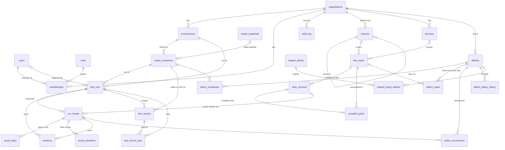

# spine.ai data model

spine.ai keeps its own database: local Postgres 17 with pgvector, address `SPINE_DB_URL` in `prototype/.env`, database `spine`. This is not Procol's database. Procol's is only ever read, with SELECT.

This document covers three things:

1. What the database held before this work, and what was missing for a multi-customer product (the audit).
2. The schema that fixes those gaps (migrations `009`–`018`), and why each choice was made.
3. How to run it, what the checks proved, and how the dashboard should show it.

---

## 1. Audit: what existed and what was missing

### What existed (migrations 001–008)

| Area | Tables | Written by | Read by |
|---|---|---|---|
| Memory (RAG) | `memory_chunks`, `memory_builds` | `src/rag/*` | the assistant, the planner |
| Run history | `runs` (the whole record as jsonb), `results` (one flat row per verdict), view `case_track_record` | `src/db/runHistory.ts`, a background copy made by `saveRun` | `/api/metrics`, `/api/track-record`, `ci-history` |
| Product model | `model_anatomy`, `model_field_rules`, `model_snapshots`, `model_templates`, `model_template_fields`, `model_units` | `src/model/store.ts` | `/api/product-model/*` |
| Assistant | `generated_cases`, `assistant_turns` | `src/agents/*` | the assistant |
| Backend watch | `backend_watch_state`, `backend_watch_log` | `scripts/backend-watch.ts` | the nightly run |
| QA vendors | `qa_vendors` | `src/checks/matrixVendors.ts` | the vendor picker |
| Success page | `metric_inputs`, `metric_snapshots` | `src/checks/metrics.ts` | `/api/metrics` |
| HubSpot | `support_tickets` | `src/hubspot/store.ts` | `/api/hubspot/*` |

The **files** that also hold the truth:

- `data/runs/*.json` is the source of truth for runs.
- `data/matrix/*.json` (bidding matrix), `procol-ui-tests/findings/crosscheck/*/result.json` (UI↔API cross-check), `data/ui-trails/*.json` (browser journeys) and `data/po-runs/*.json` (purchase-order runs) are four more run stores. None of them was in the database.
- The catalog lives only in files: `data/test-cases.json`, `data/journeys.json`, `data/api-cases*.json`, `config/featureTree.ts` and `data/compiled-plans/`.
- Defects live only in the bug workbook `docs/bugs/Procol_bugs_found_*.xlsx`.

### Gaps and errors found

1. **No tenant.** Nothing in the database said whose data a row was. `runs.company_id` was a loose integer: there was no companies table and no foreign key. One customer's data could not be kept apart from another's.
2. **No environments, users, roles or memberships.** There was no way to say UAT versus production, who started a run, or who may change what.
3. **Results were not tied to a case version.** A result only named a case id. If the case was rewritten after a run, "it passed last week" quietly meant a different case had passed. Results were also not tied to a feature or journey row, or to the client except through that loose integer.
4. **Runs had no metadata:** no trigger (manual, CI, nightly …), no spine.ai git commit, no backend commit, no status, no finish time. All of that had to be guessed from the request text.
5. **Results were flat.** A plan's sub-steps (`X·act1`) and a journey step's earlier failed tries were stored as "cases" next to real cases. This inflated case counts. See finding 13.
6. **No evidence store.** Requests and responses existed only inside the 88 MB of run JSON (and in `runs.record`). They could not be queried, sized or expired.
7. **No ledger of test records.** Nothing recorded which events, rounds, bids, proposals or vendors spine.ai created on UAT, which run made them, or whether they were cleaned up. That record is needed for traceability and for cleanup.
8. **Defects lived only in a spreadsheet.** The workbook was rebuilt by a script in a scratch folder, and its BUG numbers were positional (inserting a row renumbered everything after it). Nothing linked a defect to the runs that reproduced it.
9. **No audit trail and no retention.**
10. **Four run stores were missing from the database:** matrix, cross-check, browser journeys and PO runs. Browser journeys and PO runs are shown on the dashboard's Recent runs.
11. **Runs silently went missing from the database.** `saveRun` copies a run to the database in the background, so a script that calls `process.exit()` right after saving cuts the copy off. Reconcile found 9 runs on disk that `/api/metrics` never counted. Four scripts do this: `run-all-runnable.ts`, `run-deep2.ts`, `run-deep3.ts` and `run-ui-batch.ts`.
12. **Stale copies.** One run's database copy lagged its file (one journey step missing).
13. **The dashboard counted plan sub-steps as cases.** `metrics.ts` trust totals ("couldn't tell" rate, flaky rate, and the daily trend) counted compiled-plan sub-step rows (`<id>·act1`) as case results. The coverage code in the same file already treats those rows as not being cases. **Fixed in `src/checks/metrics.ts`** (3 queries now add `case_id NOT LIKE '%·%'`).

---

## 2. Design

### Entity–relationship diagram



### The tables, one line each

| Migration | Table / object | One line |
|---|---|---|
| 009 | `organisations` | A spine.ai customer (Procol). Holds its timezone (used for "days") and evidence retention days. |
| 009 | `environments` | Where the customer's product runs: UAT and so on, with base URLs only. `secrets_ref` names where credentials live; it never holds them. |
| 009 | `target_companies` | The Procol clients that runs act as, per environment, with an FK to the newest settings snapshot. At most one primary company. |
| 009 | `users`, `roles`, `memberships` | People and service identities (nightly, ci, backend-watch, assistant, agent, hubspot). Roles are owner, admin, qa and viewer, with a permissions matrix as data. |
| 009 | `audit_log` | Append-only: a trigger refuses UPDATE and DELETE. |
| 010 | `features`, `journeys` | The feature tree and the journeys. Items that drop out of the files are *retired*, never deleted. |
| 010 | `test_cases`, `case_versions` | One row per case id (from any source), plus every distinct content it has had, keyed by sha256. |
| 010 | `compiled_plans` | API and UI plans, versioned by hash, with the compiler's coverage verdict (full, partial or none), gaps and warnings. |
| 011 | `test_runs` | Organisation, environment, company FK, source, kind, trigger (and whether it was recorded or inferred), triggered_by, spine git sha (+ dirty flag), backend sha, status, timings, denormalised verdict counts, journey summary, record hash. |
| 011 | `run_results` | One verdict per case, journey step, matrix combination or cross-check case. Points at `case_version_id`, with `version_basis` saying how that version was decided. Also: actor, plain-English reason, HTTP status, duration. |
| 011 | `result_steps` | Plan sub-steps, earlier failed tries, matrix steps, UI steps and cross-check items. Each has expected, actual and verdict. |
| 011 | `result_assertions` | Field checks: expected, actual, verdict. |
| 011 | `evidence` | Redacted request/response pairs, screenshots and files, with a size in bytes. Each row carries `redacted CHECK (redacted)`. |
| 012 | `test_records`, `test_record_uses` | The ledger of what spine.ai made or used on UAT: Procol uuid/id/ref, the run that made it, use count, cleanup state, and a generated `named_as_test` flag. |
| 013 | `defects`, `defect_companies`, `defect_cases`, `defect_occurrences`, `defect_status_history`, `support_ticket_defects` | Defects as data. The workbook's columns are kept word for word. |
| 014 | `v_results_daily`, `v_runs_daily`, `v_case_track_record`, `v_company_overview`, `v_defect_overview`, `spine_trust_totals()` | The dashboard's numbers, per organisation, company, feature and day. |
| 015 | row-level security | One policy on every tenant table. See below. |
| 016 | `spine_apply_retention()` | Evidence retention, as a function. |
| 017 | seed | Procol, UAT, companies 198678, 32461, 47053 and 900001, a local owner and the service users. |
| 018 | widened checks | Browser-journey and PO-run sources. Seeds 900002 Decathlon (PO → Bill), which appears in PO runs. |

### Why it is built this way

- **Additive, not a rewrite.** The 001 tables `runs` and `results` are untouched and still written. Every reader that exists today keeps working. The new tables sit beside them, and `npm run db:reconcile` proves the two agree. The new run table is called `test_runs` because `runs` was taken.
- **Composite foreign keys carry `org_id`.** Every tenant table has `UNIQUE (org_id, id)`, and children reference `(org_id, parent_id)`. The database therefore makes it impossible for a result of one organisation to point at another organisation's run, case or company. `run_results` even references `(org_id, run_id, company_id)`, so a result always carries its own run's company.
- **Enums are CHECK constraints on text,** not Postgres enums. They are cheap to widen in a later migration (008 and 018 do exactly that).
- **Verdicts are four words everywhere:** `passed`, `failed`, `couldnt_tell`, `not_run`. "Couldn't tell" is never a pass. The runner's own word (worked, refused, broken, inconclusive) is kept in `raw_verdict`, because "refused" and "broken" mean different things to a reader.
- **Case versions are sha256 hashes over canonical JSON** of `{ written: <catalog entry>, automation: <library entry> }`. Changing either part makes a new version; reformatting the file does not. Positions and derived fields (`sectionNo`, `routeKind`, `runnable`) are left out, so renumbering a section is not a "new case". `version_basis` keeps this honest:
  - `recorded` means a live save pointed at the version that was current when the result was saved.
  - `backfilled` means an old run was copied in later, and the case's earliest known version is assumed.
  - `none` means the result is not a catalog case (a journey step, for example).
- **Plan sub-steps and retries are steps, not cases.** A retry that worked never erases the failure before it: the failed try is a `result_steps` row with verdict `failed`.
- **Trigger and git sha.** A caller can record the trigger (`RunRecord.trigger`, an optional field, or `SPINE_TRIGGER` for a whole process). Otherwise the trigger is inferred from the request text and marked `trigger_basis = 'inferred'`. The spine git sha is read at save time (bounded to 3 s, cached for 60 s), with a dirty flag. `backend_sha` is filled for runs the backend watcher started (from `backend_watch_log.runs`).
- **Evidence is redacted twice.** The runners already redact what they keep. `src/db/redact.ts` masks secret-named keys and secret-shaped text again on the way in, because a store holding thousands of requests must not depend on every runner remembering to.
- **The test-record ledger is keyed by `(org, environment, type, procol uuid or id)`.** The earliest run that made a record stays its maker, and later runs become uses. Shared fixtures (the QA vendors, from `qa_vendors`) are recorded as `used`. `named_as_test` flags any record that is not named `QA_Platform_…` / `API_Test_…` / `API_Journey_…`. Today it is `true` for all 1,733 records.
- **Defects.**
  - `ref` (BUG-xx, Q-xx, D-xx) is assigned once and never renumbered. CHECK constraints tie the prefix to the category.
  - A verified bug must carry a severity and a kind.
  - Status history is written by a trigger, so no writer can forget it. A re-import of the workbook updates the wording but never overwrites a status someone changed.
  - Occurrences are failed results of the defect's *exact* case ids (`defect_cases`), never anything "similar".
- **Statuses:** `needs-confirmation → open | wont-fix`, `open → confirmed`, `confirmed → fixed | wont-fix`, `fixed → confirmed` (a regression).

### Row-level security

Every tenant table has `ENABLE` and `FORCE ROW LEVEL SECURITY` and one policy, `tenant_isolation`:

```sql
USING (spine_row_visible(org_id)) WITH CHECK (spine_row_visible(org_id))
-- spine_row_visible(o) = spine_is_service() OR o = current_setting('app.org_id')
```

- **Tenant requests** run in `withOrg(db, orgId, fn)` (`src/db/tenant.ts`). That opens a transaction and sets `app.org_id` with `set_config(…, true)`, so the setting can never leak to the next user of a pooled connection. The `/api/data/*` routes all do this.
- **Platform internals** use `withService(db, fn)` (`app.role = 'service'`). These are the run writer, backfill, reconcile and retention.
- **Fail closed.** With no context set, every tenant table returns zero rows. The unit tests check this, and check that a tenant cannot *insert* a row into another organisation.
- `FORCE` makes the policies apply to the table owner too. A query that forgets `WHERE org_id = …` returns nothing instead of every customer's rows.
- **Views** are `security_invoker`, so a view never leaks.
- **Deployment step (not a migration, because it needs a superuser).** Create a separate login role named `spine_app` for tenant-facing traffic:

  ```sql
  CREATE ROLE spine_app LOGIN PASSWORD '…';
  ```

  then re-run `npm run db:migrate` (015 grants it exactly the new tables). `spine_is_service()` refuses the service path to `spine_app` even if it sets `app.role`. The local database runs everything as its single owner role, `spine`, which has no CREATEROLE. There, the policies still protect against queries that forget the organisation, but they cannot protect against the owner itself.
- **Tables from 001–008 predate organisations and have no row-level security.** They are read by platform internals only. `support_tickets` gained a nullable `org_id`, filled by the backfill.

### Retention

`spine_apply_retention(p_org DEFAULT NULL, p_dry_run DEFAULT true, p_now DEFAULT now())` is a function, not a cron.

- It deletes evidence older than `organisations.evidence_retention_days` (90 days by default).
- It keeps evidence a defect needs: evidence of a result that is a defect occurrence, and run-level evidence of a run that has one.
- It never deletes runs, results, steps, field checks, defects, test records or audit rows. Verdicts are small and they are the history; only the bulky proof expires.
- Each real (non-dry) call writes one `audit_log` row per organisation.
- `npm run db:retention` is a dry run; `npm run db:retention -- --apply` deletes.
- The run files on disk and `runs.record` are not touched.

---

## 3. Using it

| Command | What it does |
|---|---|
| `npm run db:migrate` | Applies 001–018. Safe to repeat. |
| `npm run db:backfill [-- --only catalog\|runs\|records\|defects\|tickets\|companies] [-- --force]` | Copies everything that exists into the product tables, and copies any run file the older tables never got. Idempotent: an unchanged run is skipped by its hash. |
| `npm run db:sync-catalog` | Run after `npm run cases:import`. New case versions; cases that left the files are retired. |
| `npm run db:reconcile [-- --fix] [-- --url http://localhost:PORT]` | Every dashboard number against the database. Exits 1 on a mismatch; `--fix` copies in what is missing or stale. |
| `npm run db:export-bugs -- --out <file> [--compare <old.xlsx>]` | The bug workbook, built from the defects table, and a cell-by-cell comparison. |
| `npm run db:retention [-- --apply]` | Evidence retention. |
| `npm run db:unit` | Unit tests. The database part runs in a throwaway schema and skips without `SPINE_DB_URL`. |

### Dual-write

- `saveRun` → `runHistory.writeRun` writes the older `runs`/`results` copy exactly as before. **In the same transaction**, behind a `SAVEPOINT`, it then writes the product tables. If the product part fails, the older copy still commits and the failure is logged. With the database down, the file is written as before and nothing else happens.
- Browser journeys (`trailStore.saveTrail`) and PO runs (`poRunStore.savePoRun`) get a best-effort copy too. That copy also outlives the folders' pruning.
- The matrix and cross-check stores are copied by `db:backfill` / `db:reconcile --fix`.
- `whenRunsSaved()` (new, in `runStore.ts`) waits, bounded to 15 s, for the background copies to finish. A script should await it before calling `process.exit()`.

### Routes (`src/routes/data.ts`, read only, organisation's own context)

`GET /api/data/companies` · `/api/data/companies/:procolId/runs?limit&before&kind&status` · `/api/data/trend?c&days` · `/api/data/cases/:caseKey?c` · `/api/data/defects?category&status` · `/api/data/defects/:ref` · `/api/data/test-records?c&state&type&limit&before`.

With the database down, every route answers `{ database: false }` with HTTP 200.
